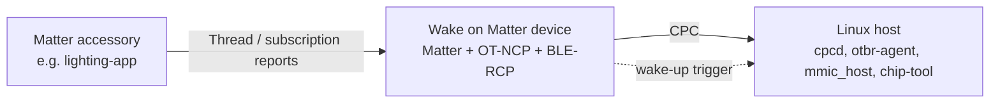

# Matter Wake on Matter Example

The Wake on Matter (WoM) example demonstrates how to run a Matter node alongside an OpenThread network co-processor (OT-NCP) and a Bluetooth Low Energy radio co-processor (BLE-RCP) on a single Silicon Labs device.

The Matter node subscribes to attributes on other Matter devices. When a subscription report matches a configured wake-up trigger, the WoM device wakes the host. The host can also access the BLE-RCP stack through the Co-Processor Communication (CPC) interface.

A typical setup includes:

- A Silicon Labs device flashed with the Wake on Matter example and connected to a Linux host, such as a Raspberry Pi, through CPC.
- A Linux host running `cpcd`, `otbr-agent`, `chip-tool`, and `mmic_host`.
- A second Matter accessory, such as the `lighting-app`, that the WoM device subscribes to.

## Contents

- [**Prerequisites**](./01-prerequisites.md)
- [**Building and Flashing the Example**](./02-build-and-flash.md)
- [**Configuring Wake on Matter**](./03-configure-wake-on-matter.md)
- [**End-to-End Validation**](./04-end-to-end-validation.md)
- [**Troubleshooting**](./05-troubleshooting.md)
