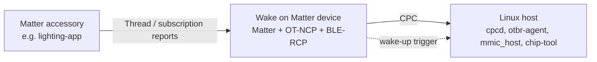

# Matter Wake on Matter Example

The Wake on Matter (WoM) example shows a Matter node running alongside an OpenThread Network Co-Processor (OT-NCP) and a Bluetooth LE Radio Co-Processor (BLE-RCP) on one Silicon Labs device.

The Matter node subscribes to attributes on other Matter devices. When a subscription report matches a wake-up trigger that you configure, the device wakes the host. The BLE-RCP stack is available to the host over the Co-Processor Communication (CPC) interface.

A typical setup includes:

- A Silicon Labs device flashed with the Wake on Matter example and connected to a Linux host, such as a Raspberry Pi, over CPC.
- A Linux host that runs `cpcd`, `otbr-agent`, `chip-tool`, and `mmic_host`.
- A second Matter accessory, such as the `lighting-app`, that the WoM device subscribes to.

## Contents

- [**Prerequisites**](./01-prerequisites.md)
- [**Building and Flashing the Example**](./02-build-and-flash.md)
- [**Configuring Wake on Matter**](./03-configure-wake-on-matter.md)
- [**End-to-End Validation**](./04-end-to-end-validation.md)
- [**Troubleshooting**](./05-troubleshooting.md)
